### 直角坐标型

简图：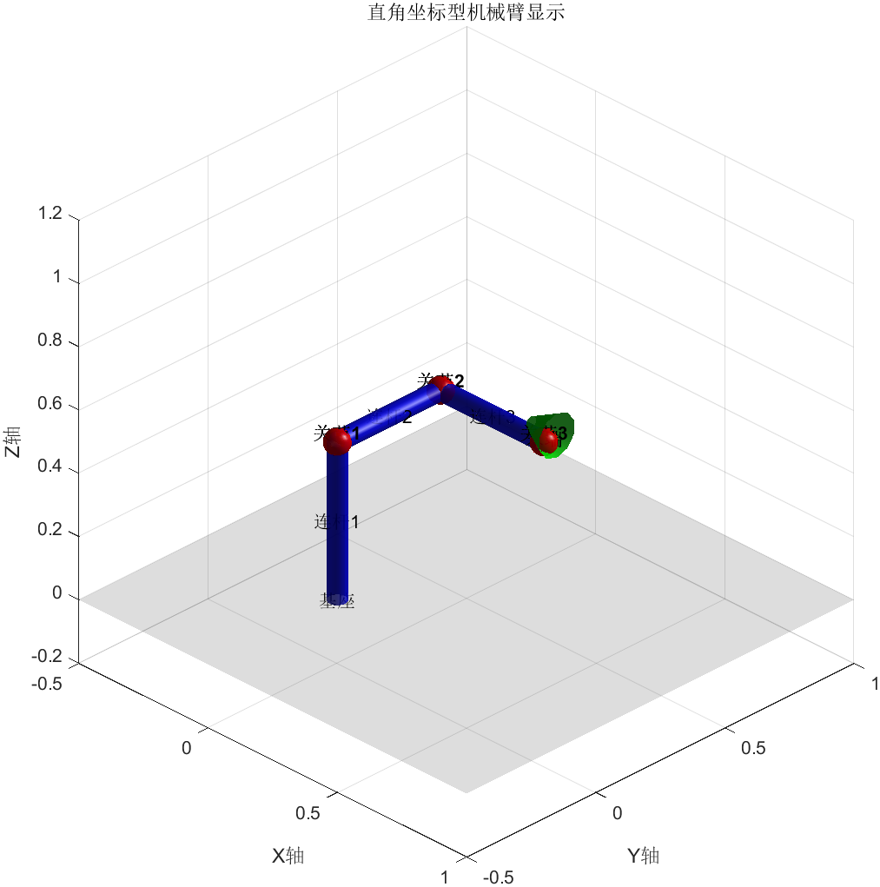

自由度：3

由3个平移关节组成，且它们的轴通常正交

与笛卡尔坐标对应：每个自由度对应一个笛卡尔空间变量

工作空间：长方体

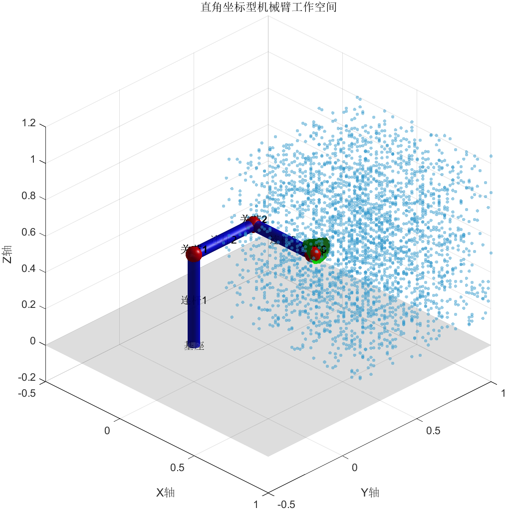

定位精度：在工作空间的任一处都恒定

机械刚度：强

操作速度：高

特点：高精度，低灵活性（因为所有关节都是平移关节）

描述方式：笛卡尔坐标系 $ (x, y, z) $

应用领域：物料搬运及装配，比如龙门架、3D打印机

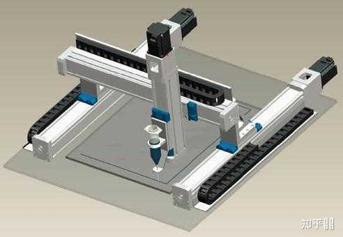

### 圆柱坐标型

简图：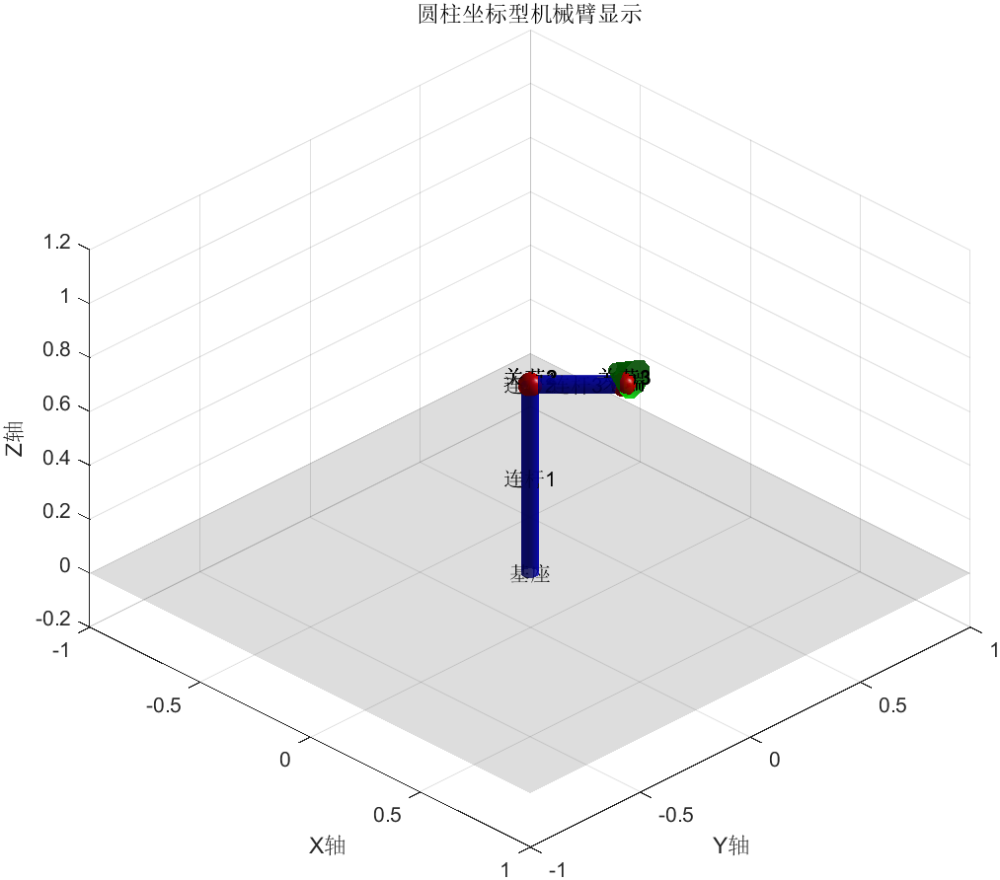

自由度：3

第1个关节为旋转关节（绕基座旋转），后2个为平移关节（垂直平移和径向平移）

与笛卡尔坐标对应：每个自由度对应一个笛卡尔空间变量

工作空间：一个中空圆柱的一部分（它无法到达距离它本身很近的地方）

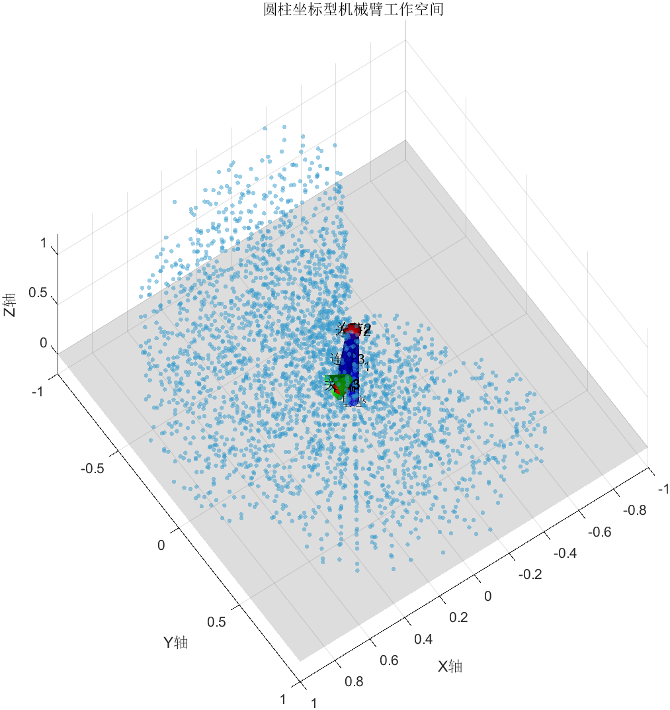

定位精度：在工作空间内不是恒定的，而是随着水平行程增加而降低

!!! 类型 原因
    我们假定旋转轴存在微小的角度误差 $ \triangle \theta $ ，这个角度误差在末端执行器处造成的切向线性误差为 $ \triangle L = R \times \triangle \theta $ 。随着R值增大，相同的角度误差 $ \triangle \theta $ 被放大成的线性误差 $ \triangle L $ 就越大。在中心附近（R很小），旋转误差几乎可以忽略；但在手臂完全伸展时（R最大），旋转误差的影响达到最大。

机械刚度：强

操作速度：中

描述方式：圆柱坐标系 $ (\rho, \varphi, z) $

应用领域：搬运大尺寸的物体

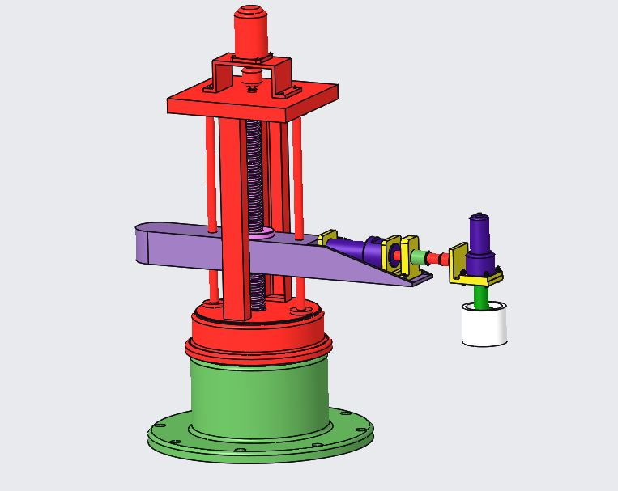

### 球坐标型

简图：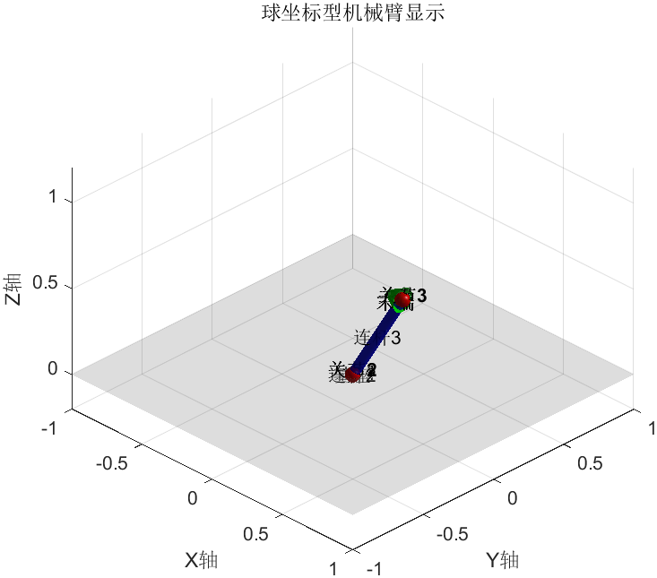

自由度：3

前2个关节为旋转关节（一个绕基座旋转，一个控制手臂俯仰），最后一个为平移关节（径向伸缩）

工作空间：一个空心球体的一部分，它可以触及地板上的物体

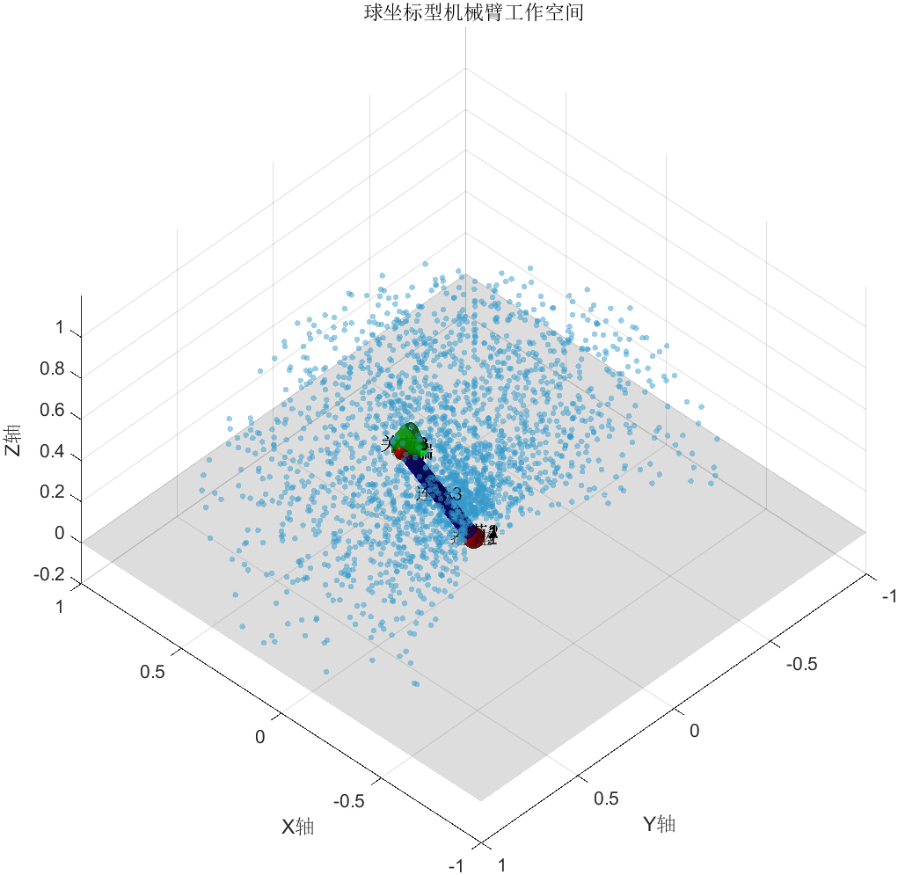

定位精度：随着径向行程增加而降低

!!! 类型 原因

    1. 方位角误差( $ \triangle \theta $ )的放大：

    基座旋转轴的角度误差 $ \triangle \theta $ 会在末端产生一个切向误差 $ \triangle L_{\theta} = R \times \triangle \theta \times sin(\varphi)$ 。

    当手臂水平时( $ \varphi = 90°，sin(\varphi) = 1 $ )，误差被完全放大， $ \triangle L_{\theta} = R \times \triangle \theta $ 。当手臂趋向垂直时( $ \varphi \to 0°或180°, sin(\varphi) \to 0 $ )，$ \triangle L_{\theta} $ 也趋向于0。但这并不意味着精度变高，反而引入了其他问题（奇点）。

    **奇点**：当机器人的俯仰角 $ \varphi $ 为0°（手臂笔直向上）或180°（手臂笔直向下）时，机器人丢失了一个运动自由度。

    在奇点附近，基座旋转轴 $ \theta $ 的微小运动几乎无法改变末端执行器的实际位置。这意味着为了微调末端的位置， $ \triangle \theta $ 轴需要产生极大的运动量，导致控制分辨率急剧下降，精度和重复性严重丧失。

    2. 俯仰角误差( $ \triangle \varphi $ )的放大：

    控制手臂俯仰的轴的角度误差 $ \triangle \varphi $ 会在末端产生一个垂直于手臂方向的误差 $ \triangle L_{\varphi} = R \times \triangle \varphi $ 。

    俯仰角误差会直接且完整地被手臂长度R放大，这与 $ \varphi $ 角本身无关。

机械刚度：中，不如前两个，机械结构更为复杂

操作速度：中

描述方式：球坐标系 $ (r, \theta, \varphi) $

应用领域：机械加工

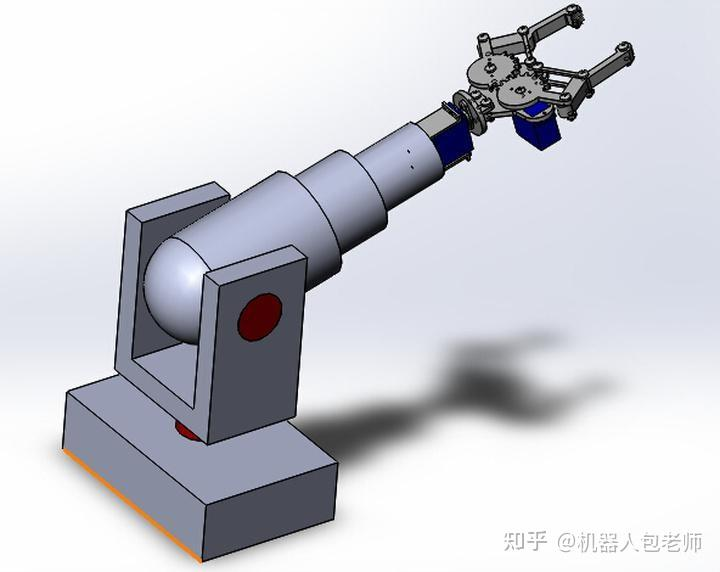

### SCARA(Selective Compliance Assembly Robot Arm)型

简图：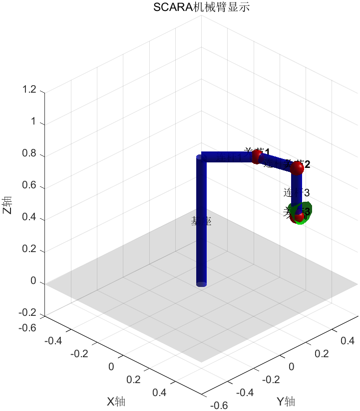

自由度：3

前2个关节为旋转关节（一个绕基座旋转，一个驱动小臂相对于大臂在水平面内旋转），最后一个为平移关节（垂直伸缩）。这三个关节的轴线相互平行，都是竖直的。

与笛卡尔坐标对应：自由度和笛卡尔空间变量之间的对应关系只适用于用笛卡尔坐标描述的任务的垂直分量

工作空间：形状如下图所示

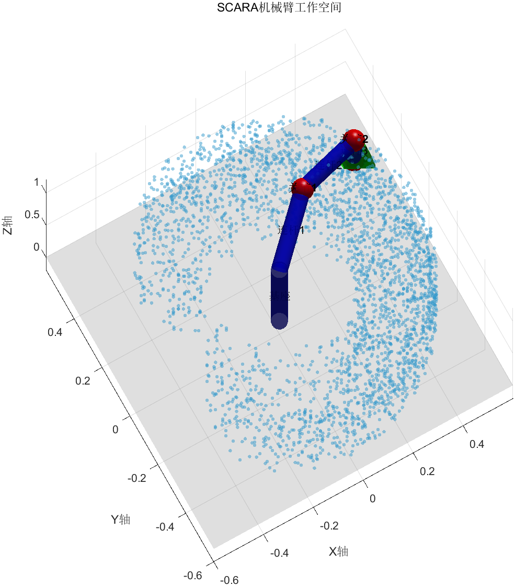

定位精度：随着手臂的伸展长度（即末端距离基座中心的距离）的增加而降低

原因类似于圆柱型机械臂，这里不再赘述

机械刚度：垂直刚度高

操作速度：高

应用领域：垂直组装任务；小零件的操作

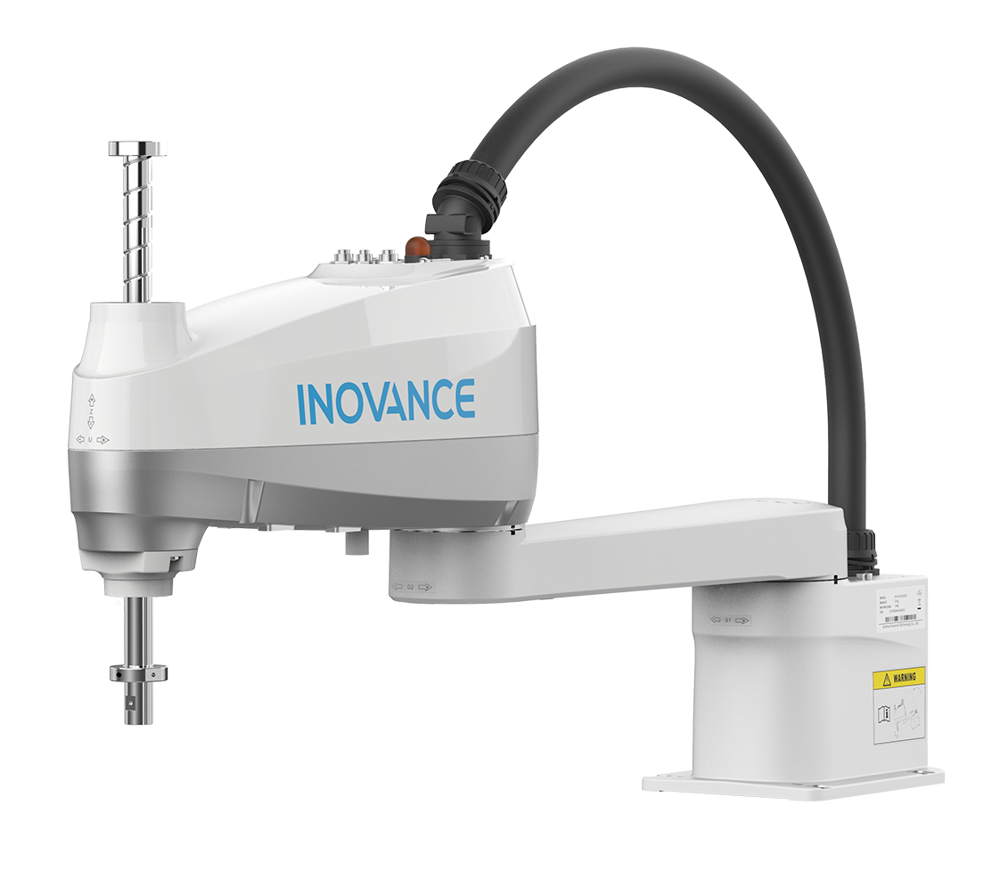

### PUMA

简图：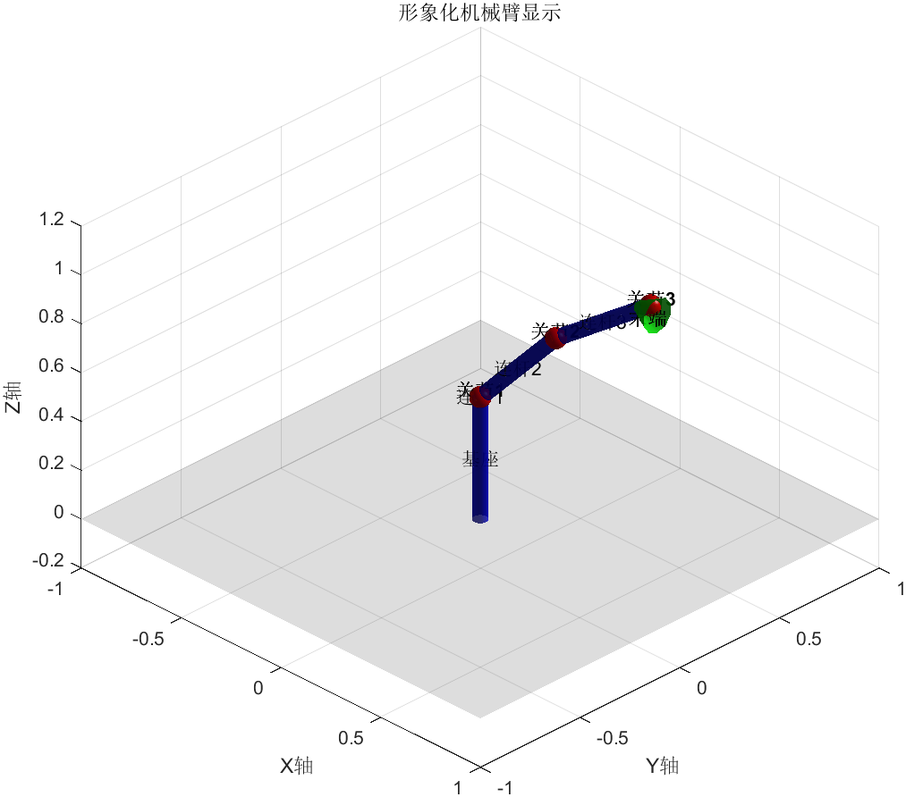

自由度：3

3个旋转关节（一个绕基座旋转，一个驱动大臂相对于基座在竖直面内旋转，一个驱动小臂相对于大臂在竖直面内旋转）。后两个关节的轴相互平行，都与第一个关节的轴正交。

工作空间：球体的一部分

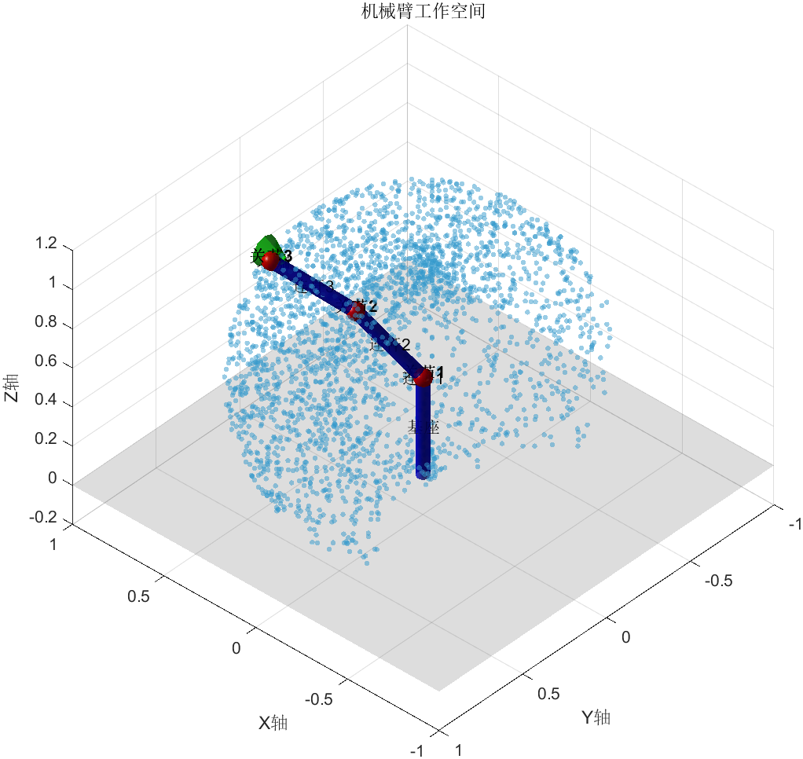

定位精度：随着半径增大而降低

机械刚度：低

操作速度：高

特点：灵活度最高

应用领域：广泛（焊接、喷涂、组装等）

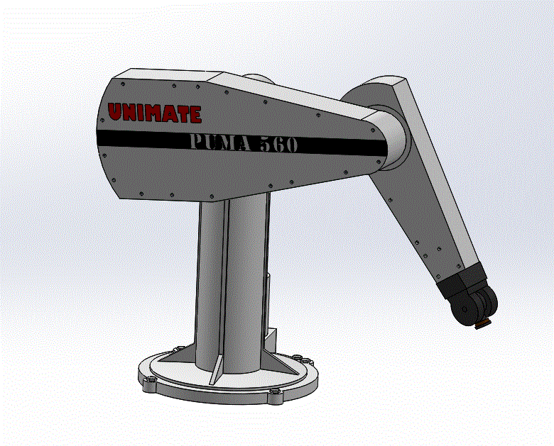